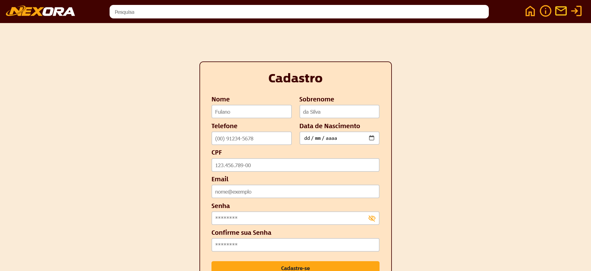
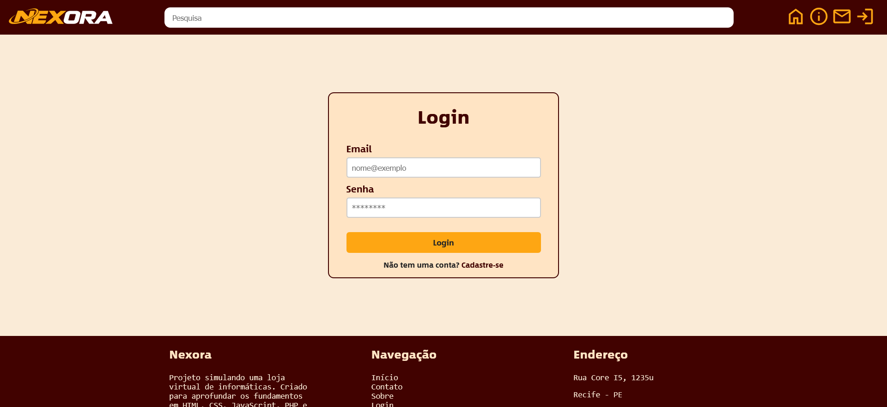
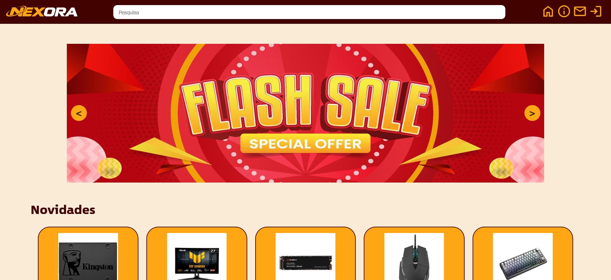
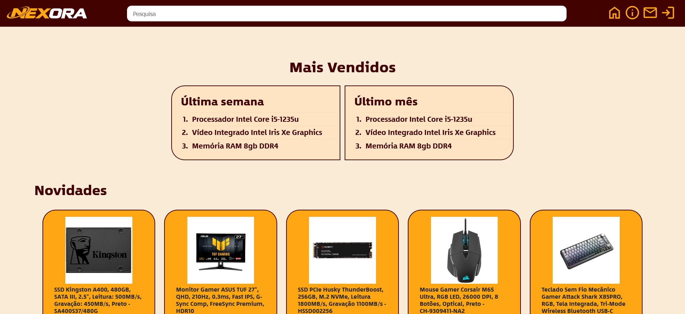
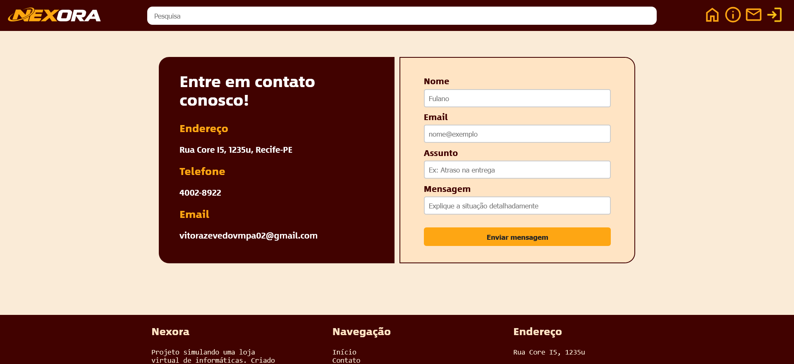
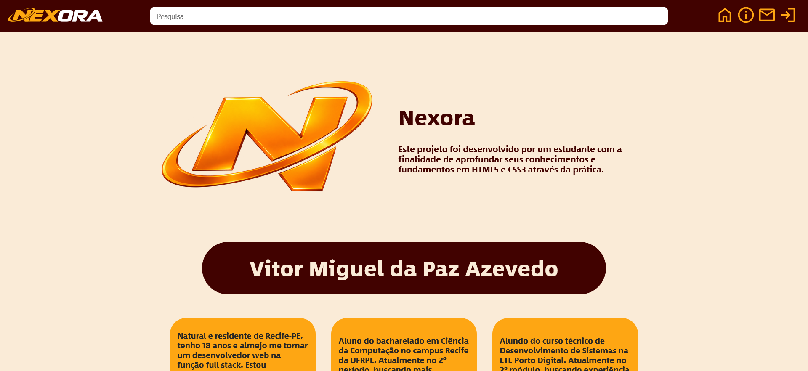
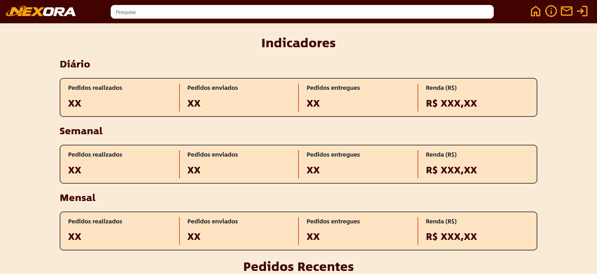

# Manual do usuário

Bem-vindo ao **Nexora**, a sua loja de peças de computador, hardware e periféricos. Este manual ensina, passo a passo, como usar o site. Não precisa saber de computação: é só seguir cada etapa.

## O que você encontra neste manual

- Como criar minha conta
- Como entrar e sair do site
- Como ver e buscar os produtos
- Como falar com a loja
- Como conhecer mais sobre o Nexora
- (Administrador) Como ver o painel da loja
- Perguntas frequentes

---

## O menu do site

No topo de todas as páginas fica o menu principal e a barra de pesquisa:

| Botão | Para que serve |
|-------|----------------|
| **Barra de pesquisa** | Permite procurar peças pelo nome direto no topo da tela |
| **Início** | Volta para a página inicial com as novidades e ofertas em destaque |
| **Produtos** | Mostra os mais vendidos e todos os produtos separados por categoria |
| **Sobre** | Conta a história e o objetivo do Nexora |
| **Contato** | Abre o formulário e os canais para falar com a loja |
| **Login** | Para entrar na sua conta (aparece só quando você ainda não entrou) |
| **Dashboard** | Abre o painel de vendas da loja (aparece depois que você entra) |
| **Logout** | Sai da sua conta com segurança |

---

## Como criar minha conta

Você só precisa criar a conta uma vez.

1. No menu, toque em **Login**.
2. Na tela de login, toque em **Cadastre-se**.
3. Digite o seu **nome** e o seu **sobrenome**.
4. Digite o seu **telefone**.
5. Informe a sua **data de nascimento**.
6. Digite o seu **CPF**.
7. Digite o seu **e-mail**.
8. Crie uma **senha** e digite a mesma senha em **Confirmar senha**.
9. Toque em **Cadastrar**.

Pronto! Sua conta é criada e você já pode entrar no site com o seu e-mail e senha.

> **Dica:** para conferir a senha que você digitou, toque no desenho do olho ao lado do campo. Toque de novo para esconder.

> **Atenção:** cada e-mail e CPF só pode ter uma conta. Se o site avisar que o e-mail ou CPF já está cadastrado, volte para a tela de **Login** e entre na sua conta.

---

## Como entrar e sair do site

### Entrar

1. No menu, toque em **Login**.
2. Digite o seu **e-mail**.
3. Digite a sua **senha**.
4. Toque em **Entrar**.

Pronto! Você entra na sua conta e o menu passa a mostrar **Dashboard** e **Logout**.

Se aparecer uma mensagem de e-mail ou senha incorretos, confira se digitou tudo certo e verifique se a tecla de letras maiúsculas (*Caps Lock*) não está ativada.

### Sair

1. No menu do topo, toque em **Logout**.

Pronto! Sua sessão é encerrada e você volta para a área de visitante. Sempre saia da conta quando usar um computador público ou compartilhado.

---

## Como ver e buscar os produtos

1. Na página **Início**, role a tela para ver o banner principal, as **Novidades** e as **Ofertas** em destaque.

2. Para ver o catálogo completo, toque em **Produtos** no menu.
3. No topo da página de produtos, confira o ranking dos **Mais vendidos** da semana e do mês.
4. Role a página ou escolha uma categoria de hardware: **Processadores**, **Placas de Vídeo**, **Memórias RAM**, **SSDs**, **Coolers** ou **Placas-mãe**.
5. Se preferir ir direto a uma peça, digite o nome dela na **barra de pesquisa** no topo do site.

Pronto! Cada produto mostra a foto, o nome, a descrição técnica e o preço.

> **Atenção:** a finalização de compras pelo carrinho online será liberada em uma próxima atualização do sistema. Por enquanto, você já pode consultar todo o catálogo, especificações e preços.

---

## Como falar com a loja

Você não precisa estar logado para enviar uma mensagem.

1. No menu, toque em **Contato**.
2. No formulário, digite o seu **nome**.
3. Digite o seu **e-mail**, para a equipe saber onde responder.
4. Digite o **assunto** (por exemplo: *"Dúvida sobre compatibilidade"*).
5. Escreva a sua **mensagem**.
6. Toque em **Enviar**.

Pronto! Sua mensagem é enviada para a equipe do Nexora. Na mesma tela, você também encontra o endereço, o telefone e o e-mail de atendimento da loja.

---

## Como conhecer mais sobre o Nexora

Você não precisa estar logado para acessar esta página.

1. No menu do topo, toque em **Sobre**.
2. Role a tela para ler a apresentação institucional do projeto Nexora e conhecer os detalhes da plataforma.

Pronto! Você visualiza todas as informações sobre a criação e o propósito da loja.

---

## (Administrador) Como ver o painel da loja

Esta área é exclusiva para quem administra uma loja no Nexora.

1. Entre no site com a sua conta de lojista/administrador.
2. No menu do topo, toque em **Dashboard**.

No topo do painel, você acompanha os indicadores de desempenho nos períodos **Diário**, **Semanal** e **Mensal**:

| Indicador | O que significa |
|-----------|-----------------|
| **Pedidos Realizados** | Quantos pedidos novos a loja recebeu no período |
| **Enviados** | Quantos pedidos já saíram para entrega |
| **Entregues** | Quantos pedidos já chegaram ao cliente |
| **Renda** | Valor total faturado pela loja no período |

Logo abaixo dos indicadores, a tabela **Pedidos Recentes** exibe as últimas compras feitas na loja com os detalhes de cada pedido para acompanhamento.

> **Atenção:** se você tentar abrir o painel sem estar logado ou sem ter uma loja vinculada à sua conta, o acesso não é liberado.

---

## Perguntas frequentes

**Esqueci minha senha. E agora?**
O site ainda não possui recuperação automática de senha. Entre em contato com a equipe pela página **Contato** informando o seu e-mail de cadastro, ou crie uma nova conta com outro e-mail.

**Não consigo entrar, mesmo digitando o e-mail certo.**
Confira a senha letra por letra e veja se o *Caps Lock* não está ligado. Se ainda não tiver cadastro, clique em **Cadastre-se** na tela de login.

**Já posso finalizar uma compra direto pelo site?**
Ainda não. Nesta versão você já pode navegar pelas vitrines, pesquisar peças e consultar preços; o carrinho e o pagamento online serão ativados em breve.

**Quanto tempo a loja demora para responder minha mensagem?**
Nossa equipe responde o mais breve possível diretamente no e-mail que você informou no formulário de **Contato**.