# Pontos da Sprint 01

## PONTO 01 — Diagnóstico do módulo e organização do trabalho

* **Arquivos reais:** `index.php`, `cadastro.php`, `login.php`, `logout.php`, `dashboard.php`, `perfil.php`, `config/conexao.php`, `assets/php/functions.php`, `database/nexora.sql`, `database/sprint01.sql`, `docs/telas-e-fluxos.md`, `docs/banco-de-dados.md`.

* **Teste positivo:** Mapeamento completo dos arquivos existentes e integração do módulo de usuários sem quebrar as páginas institucionais e de vitrine (`inicio.php`, `produtos.php`, `sobre.php`, `contato.php`). Autenticação validada com redirecionamento automático em `index.php` e controle de acesso por sessão e loja em `dashboard.php` e `perfil.php`.

* **Teste de erro / limite:** Tentativa de acessar `dashboard.php` sem sessão ativa (redirecionado por `exigirLogin()` para `login.php`) e acesso a `dashboard.php` autenticado com usuário comum sem loja vinculada (`bigas@teste.com`), redirecionado para `perfil.php` por `usuarioPodeAcessarDashboard()`.

* **Resultado:** `[x] Atendeu` `[ ] Atendeu parcialmente` `[ ] Pendente` | **Evidência:** `docs/evidencias/p01-protecao-rotas.png`, `docs/telas-e-fluxos.md` e `docs/banco-de-dados.md`.

  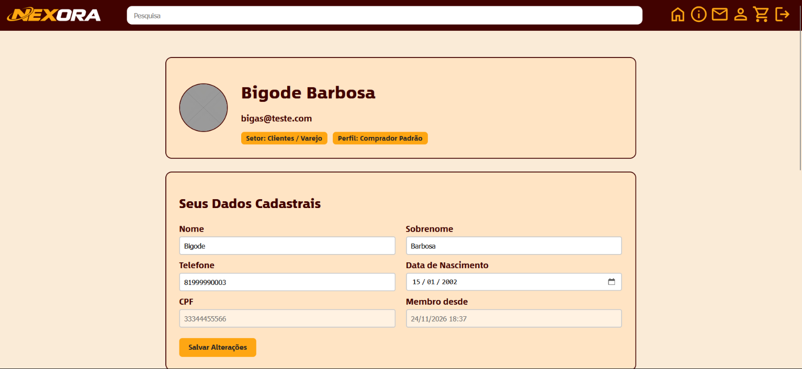

* **Pendências:** Atualizar o mapa textual em `docs/telas-e-fluxos.md` para incluir explicitamente os campos de setor/perfil no cadastro e a tabela de gestão de usuários no dashboard.

## PONTO 02 — Estrutura MySQL, relacionamentos e integridade

* **Arquivos reais:** `database/nexora.sql`, `database/sprint01.sql`, `docs/banco-de-dados.md`.

* **Teste positivo:** Importação limpa de `database/nexora.sql` seguida de `database/sprint01.sql` no banco `nexora`, criando as tabelas `setores`, `perfis` e `auditoria_usuarios`, adicionando `id_setor`, `id_perfil`, `status`, `atualizado_em` e `desativado_em` em `usuarios` com chaves estrangeiras (`ON UPDATE CASCADE`) e populando registros fictícios de homologação.

* **Teste de erro / limite:** Tentativa de `INSERT` direto no MySQL com e-mail já existente (`admin@nexora.com`) e chave estrangeira inexistente (`id_setor = 999`), bloqueados pelas restrições `UNIQUE` e `FOREIGN KEY` do banco.

* **Resultado:** `[x] Atendeu` `[ ] Atendeu parcialmente` `[ ] Pendente` | **Evidência:** `docs/evidencias/p02-estrutura-relacionamentos.png` e `docs/evidencias/p02-erro-integridade.png`.

  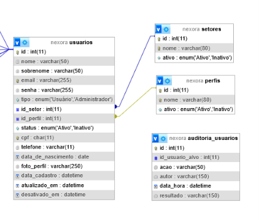
  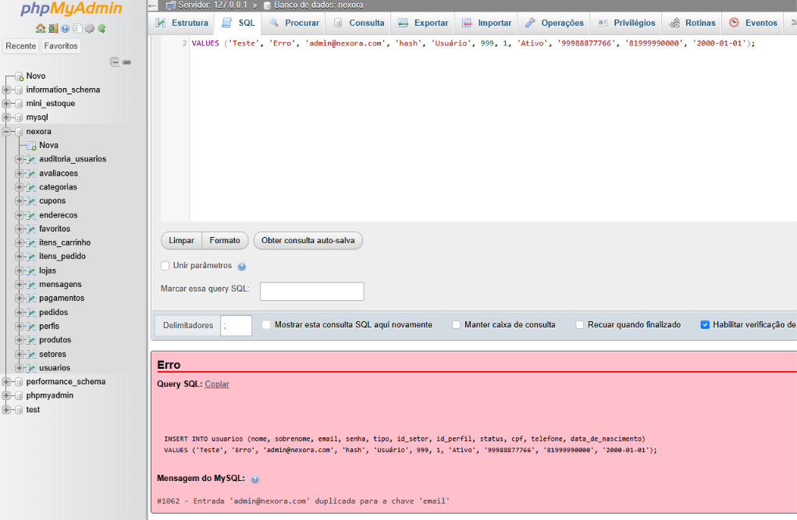

* **Pendências:** O modelo adotou o par `status = 'Ativo'/'Inativo'` e `desativado_em` no lugar de `'Baixa'`/`baixado_em` sugeridos como referência; `sprint01.sql` exige execução sobre base `nexora.sql` recém-importada por conter `ALTER TABLE ADD COLUMN`.

## PONTO 03 — Conexão PHP / MySQL com PDO

* **Arquivos reais:** `config/conexao.php`, `cadastro.php`, `dashboard.php`, `perfil.php`, `login.php`.

* **Teste positivo:** Conexão centralizada em `config/conexao.php` utilizando `PDO` com `charset=utf8mb4`, `PDO::ERRMODE_EXCEPTION`, `PDO::FETCH_ASSOC` e `PDO::ATTR_EMULATE_PREPARES => false`, comprovada pela leitura real de setores, perfis e usuários nas telas do sistema sem credenciais sensíveis expostas na documentação.

* **Teste de erro / limite:** Simulação controlada de indisponibilidade do banco (interrupção temporária do serviço MySQL no XAMPP durante o acesso ao sistema), verificando que o bloco `catch (PDOException $e)` registra o erro técnico via `error_log()` e exibe apenas a mensagem segura `"Não foi possível conectar ao sistema. Tente novamente mais tarde."`.

* **Resultado:** `[x] Atendeu` `[ ] Atendeu parcialmente` `[ ] Pendente` | **Evidência:** `docs/evidencias/p03-falha-pdo.png` e `config/conexao.php`.

  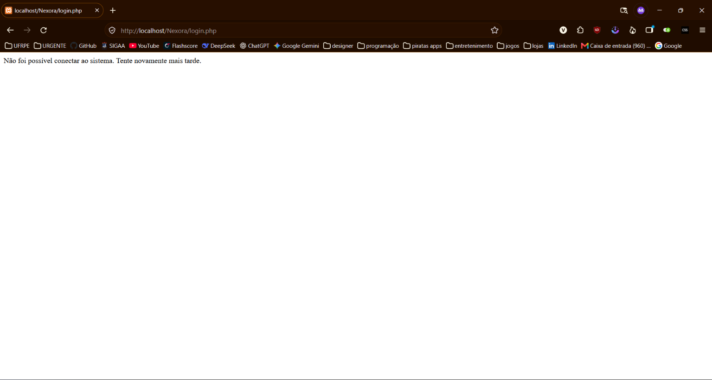

* **Pendências:** Nenhuma.

## PONTO 04 — Consulta às tabelas relacionadas no formulário

* **Arquivos reais:** `cadastro.php`.

* **Teste positivo:** Carregamento dinâmico dos campos `<select id="id_setor">` e `<select id="id_perfil">` em `cadastro.php` a partir das consultas `SELECT id, nome FROM setores WHERE ativo = "Ativo" ORDER BY nome` e `SELECT id, nome FROM perfis WHERE ativo = "Ativo" ORDER BY nome`, enviando os respectivos `id` numéricos ao servidor.

* **Teste de erro / limite:** Verificação do tratamento condicional para listas vazias (`if (empty($setores))` e `if (empty($perfis))`), exibindo opção desabilitada informativa sem quebrar a renderização do formulário.

* **Resultado:** `[x] Atendeu` `[ ] Atendeu parcialmente` `[ ] Pendente` | **Evidência:** `docs/evidencias/p04-selects-banco-setor.png` e `docs/evidencias/p04-selects-banco-perfil.png`.

  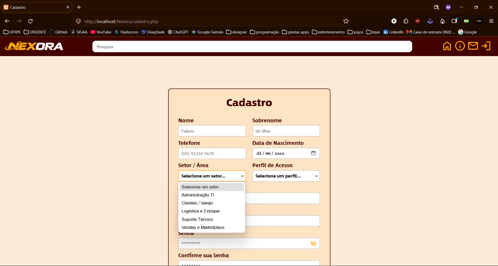
  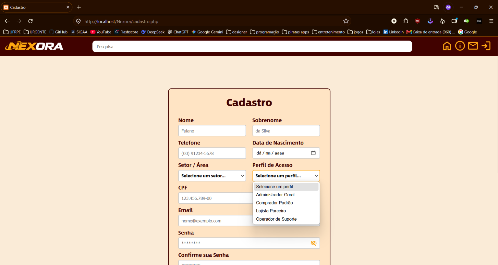

* **Pendências:** Nenhuma.

## PONTO 05 — Formulário funcional e validação de entrada

* **Arquivos reais:** `cadastro.php`, `assets/js/formularios.js`, `assets/css/style.css`.

* **Teste positivo:** Submissão válida do formulário `cadastro.php` com validação no cliente (`formularios.js`) e validação completa no servidor (`cadastro.php`), conferindo campos obrigatórios, formato de e-mail (`FILTER_VALIDATE_EMAIL`), CPF de 11 dígitos, telefone (10 ou 11 dígitos), data de nascimento no passado, senha mínima de 8 caracteres e existência/status ativo de `id_setor` e `id_perfil`.

* **Teste de erro / limite:** Submissão forjada via console do navegador ignorando a validação JavaScript (teste `T02`) e envio de `id_setor` inexistente (teste `T04`), comprovando que o PHP recusa a operação, exibe aviso claro e preserva os valores não sensíveis digitados (`nome`, `sobrenome`, `telefone`, `dataNascimento`, `id_setor`, `id_perfil`, `cpf`, `email`).

* **Resultado:** `[x] Atendeu` `[ ] Atendeu parcialmente` `[ ] Pendente` | **Evidência:** `docs/evidencias/p05-validacao-servidor.png`.

  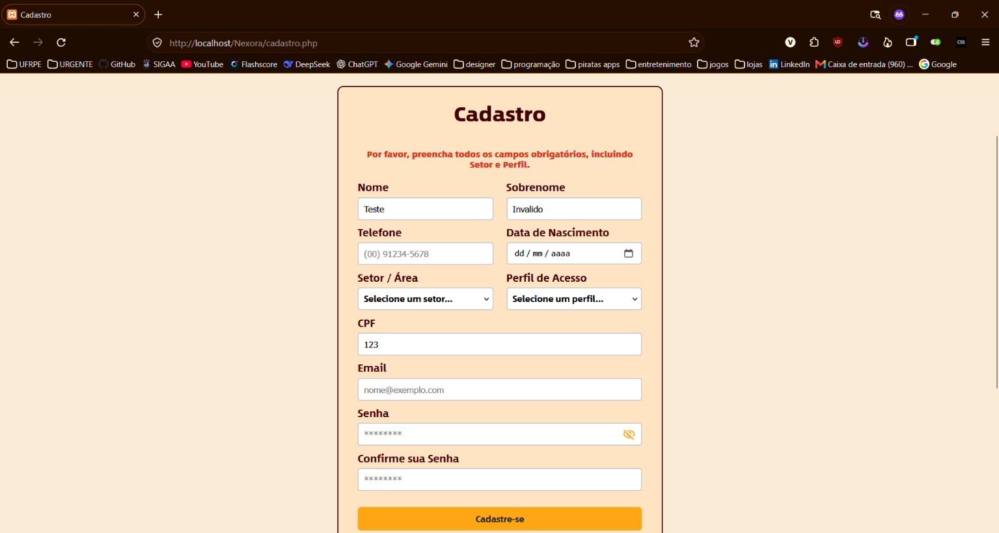

* **Pendências:** A validação no servidor exibe uma mensagem única consolidada no topo do formulário em vez de mensagens individuais abaixo de cada campo.

## PONTO 06 — INSERT real e resposta do cadastro

* **Arquivos reais:** `cadastro.php`, `login.php`.

* **Teste positivo:** Cadastro de novo usuário válido em `cadastro.php` (teste `T01`: `aluno.t01@teste.com`), executando transação (`beginTransaction`/`commit`) com `INSERT` preparado em `usuarios` (senha protegida com `password_hash()`) e gravação de evento `CADASTRO` em `auditoria_usuarios`, seguido de redirecionamento para `login.php` com mensagem de confirmação e persistência comprovada após recarregar e consultar o MySQL.

* **Teste de erro / limite:** Tentativa de cadastro com e-mail já existente (`bigas@teste.com`, teste `T03`) e com ID de setor/perfil inexistente (teste `T04`), rejeitados sem duplicar registros e sem expor mensagens SQL técnicas.

* **Resultado:** `[x] Atendeu` `[ ] Atendeu parcialmente` `[ ] Pendente` | **Evidência:** `docs/evidencias/p06-erro-duplicidade.png`, `docs/evidencias/p06-cadastro-sucesso.png` e `docs/evidencias/p06-banco-persistencia.png`.

  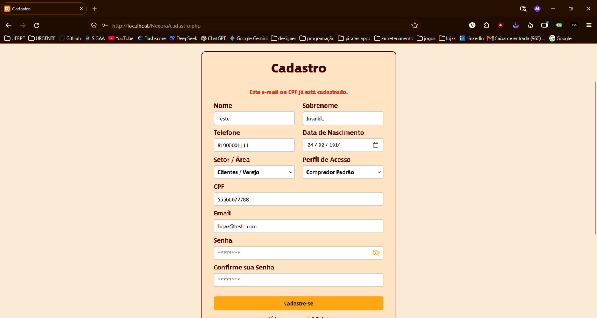
  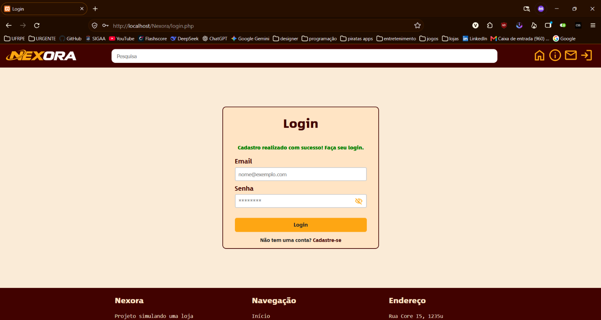
  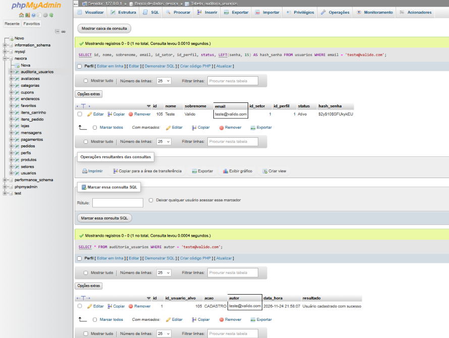

* **Pendências:** Nenhuma.

## PONTO 07 — Consultas SELECT e listagem de usuários

* **Arquivos reais:** `dashboard.php`.

* **Teste positivo:** Listagem dinâmica de usuários em `dashboard.php` filtrada por `WHERE u.status = "Ativo"`, refletindo novos cadastros após recarregar a página, e pesquisa por nome ou e-mail existente (teste `T05`, termo `Bigode`) com parâmetros preparados (`LIKE`).

* **Teste de erro / limite:** Pesquisa por termo inexistente e entrada com payload `' OR '1'='1` (testes `T05` e `T12`), comprovando que a consulta preparada trata o texto literalmente, não altera a lógica SQL e exibe `"Nenhum usuário ativo encontrado para a consulta informada."`, além de omitir usuários com `status = "Inativo"`.

* **Resultado:** `[x] Atendeu` `[ ] Atendeu parcialmente` `[ ] Pendente` | **Evidência:** `docs/evidencias/p07-p08-listagem-join.png`, `docs/evidencias/p07-busca-encontrada.png` e `docs/evidencias/p07-busca-vazia-segura.png`.

  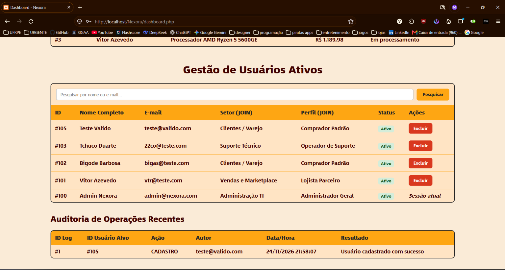
  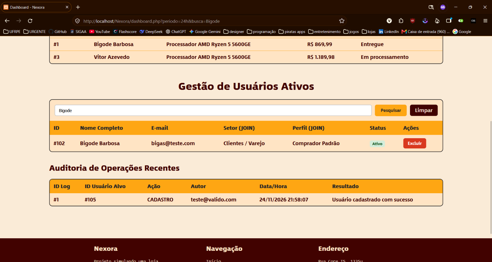
  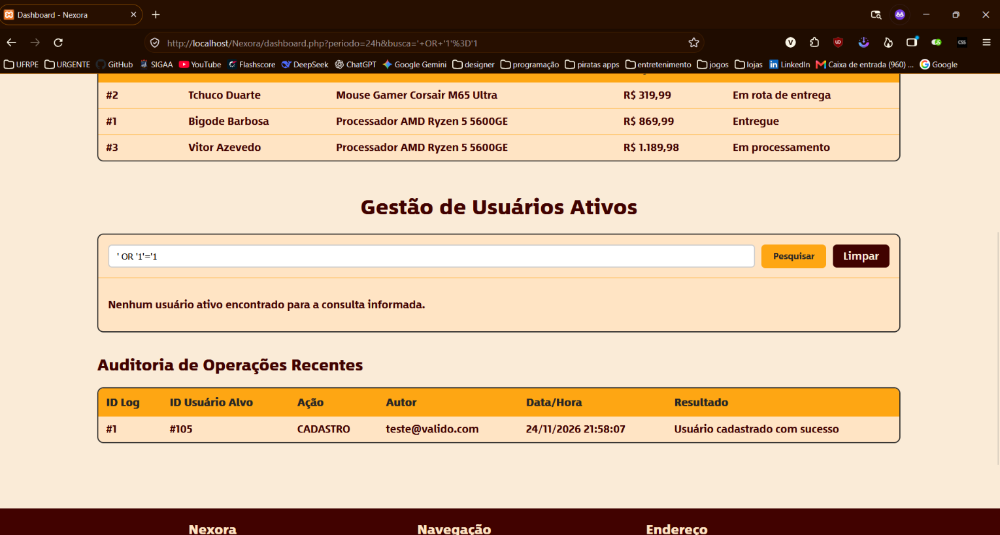

* **Pendências:** Nenhuma.

## PONTO 08 — JOIN entre usuários, setores e perfis

* **Arquivos reais:** `dashboard.php`, `perfil.php`.

* **Teste positivo:** Consulta relacional em `dashboard.php` e `perfil.php` unindo `usuarios u`, `setores s` (`ON u.id_setor = s.id`) e `perfis p` (`ON u.id_perfil = p.id`) via `INNER JOIN` (teste `T06`), exibindo os nomes de setor e perfil na tabela administrativa e nos badges do perfil sem duplicação de registros.

* **Teste de erro / limite:** Alteração do nome de um setor diretamente na tabela `setores` (`id = 3`, teste `T07`), comprovando que a interface passa a exibir o novo nome automaticamente via `JOIN` sem redundância nem alteração na tabela `usuarios`.

* **Resultado:** `[x] Atendeu` `[ ] Atendeu parcialmente` `[ ] Pendente` | **Evidência:** `docs/evidencias/p07-p08-listagem-join.png` e `docs/evidencias/p08-join-atualizado.png`.

  
  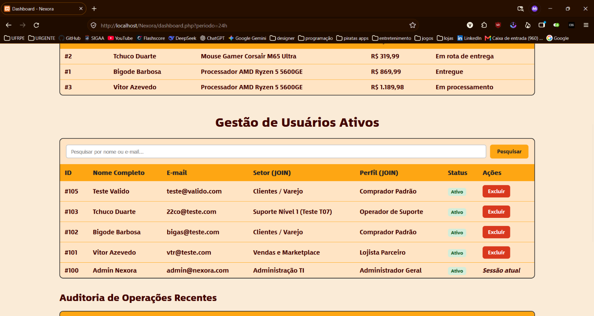

* **Pendências:** Nenhuma.

## PONTO 09 — Pergunta de confirmação antes de excluir

* **Arquivos reais:** `dashboard.php`, `perfil.php`, `assets/js/functions.js`, `assets/css/style.css`.

* **Teste positivo:** Acionamento do botão **Excluir** em `dashboard.php` (`abrirModalExclusao()`), abrindo o modal `#modal-exclusao` com a pergunta `"Deseja realmente excluir este usuário?"`, identificação explícita do ID, nome e e-mail do usuário selecionado (`#102 - Bigode Barbosa`) e botões **Cancelar** e **Confirmar**. Ao clicar em **Cancelar** (teste `T08`), o modal fecha e o usuário permanece `Ativo` sem envio de requisição ao servidor.

* **Teste de erro / limite:** Ocultação do botão de exclusão para o próprio usuário autenticado (`Sessão atual`) e limpeza do campo `modal-usuario-id` ao cancelar o modal (`fecharModalExclusao()`).

* **Resultado:** `[x] Atendeu` `[ ] Atendeu parcialmente` `[ ] Pendente` | **Evidência:** `docs/evidencias/p09-modal-confirmacao.png`.

  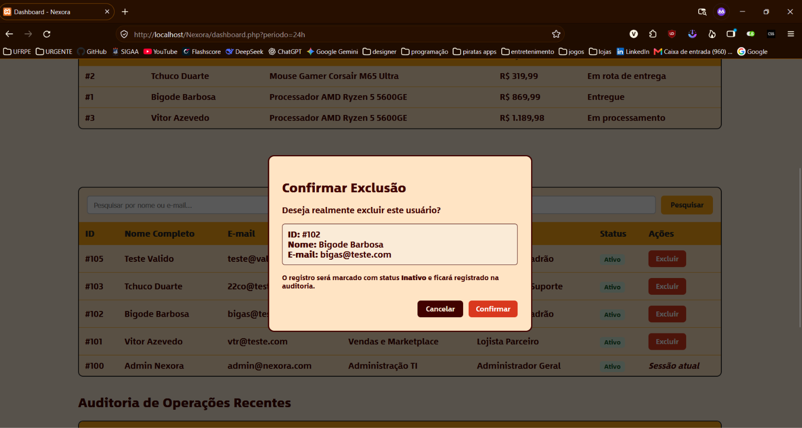

* **Pendências:** Nenhuma.

## PONTO 10 — Exclusão segura, auditoria e entrega integrada

* **Arquivos reais:** `dashboard.php`, `perfil.php`, `assets/php/functions.php`, `database/sprint01.sql`, `README.md`, `docs/relatorio-sprint01.md`.

* **Teste positivo:** Confirmação da exclusão no modal de `dashboard.php` (teste `T09`), validando `POST`, autenticação, permissão, token CSRF (`validarTokenCsrf()`) e ID válido; marcando `status = "Inativo"`, `atualizado_em = NOW()` e `desativado_em = NOW()`; removendo o registro da listagem de ativos; e gravando o evento `INATIVACAO_USUARIO` em `auditoria_usuarios` com autor, data/hora e resultado.

* **Teste de erro / limite:** Tentativa de exclusão via `GET` na URL, envio de `POST` com token CSRF inválido (`T10`) e repetição da confirmação para usuário já desativado (`T11`), todos bloqueados com mensagens controladas e preservação dos dados no banco.

* **Resultado:** `[x] Atendeu` `[ ] Atendeu parcialmente` `[ ] Pendente` | **Evidência:** `docs/evidencias/p10-exclusao-auditoria.png` e `docs/evidencias/p10-bloqueio-csrf.png`.

  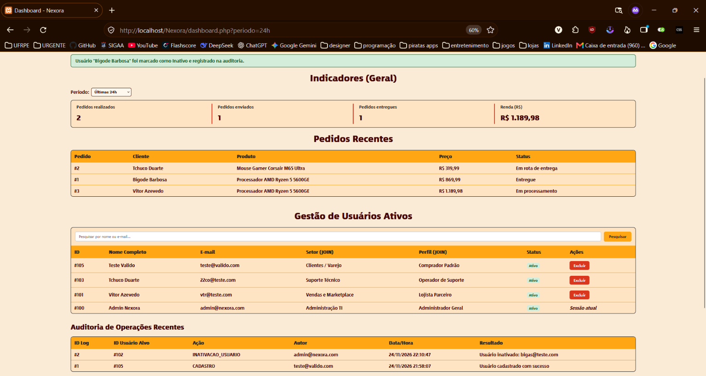
  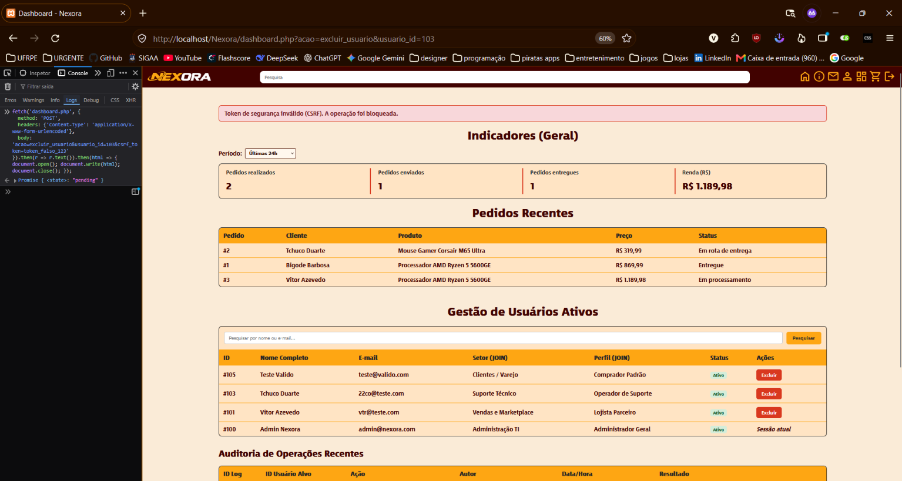

* **Pendências:** Nomenclatura de status adotada como `'Inativo'`/`desativado_em` no lugar de `'Baixa'`/`baixado_em`; páginas externas ao escopo da Sprint 01 (`carrinho.php`, `contato.php` e catálogo dinâmico) seguem planejadas no `CHANGELOG.md`.

# Registro final da equipe

| Campo de fechamento | Preenchimento |
| :--- | :--- |
| Resumo da implementação | Implementado e integrado ao Nexora o módulo completo de cadastro, consulta relacional com `JOIN` e exclusão lógica confirmada de usuários utilizando PHP 8.2, PDO e MySQL, mantendo preservadas as páginas institucionais e de vitrine existentes fora do escopo da Sprint 01. |
| Arquivos adicionados/alterados | **Adicionados:** `database/sprint01.sql`, `perfil.php`, `logout.php`, `assets/js/functions.js`, `docs/relatorio-sprint01.md` e capturas em `docs/evidencias/`. **Alterados:** `config/conexao.php`, `assets/php/functions.php`, `cadastro.php`, `login.php`, `dashboard.php`, `index.php`, `paginas/header.php`, `paginas/footer.php`, `assets/css/style.css`, `assets/js/formularios.js`, `docs/banco-de-dados.md`, `docs/instalacao.md`, `CHANGELOG.md` e `README.md`. |
| Consultas SQL / JOIN explicados | `cadastro.php` consulta `setores` e `perfis` ativos para popular os `<select>` e executa `INSERT` preparado em `usuarios` e `auditoria_usuarios`. `dashboard.php` e `perfil.php` executam `SELECT` com `INNER JOIN setores s ON u.id_setor = s.id` e `INNER JOIN perfis p ON u.id_perfil = p.id`, relacionando as chaves estrangeiras às chaves primárias sem duplicar nomes textuais em `usuarios` (evitando redundância e anomalias de atualização). |
| Exclusão e auditoria verificadas | A exclusão em `dashboard.php` exige confirmação prévia em modal com ID, nome e e-mail do alvo e botões `Cancelar`/`Confirmar`. Ao confirmar, valida `POST`, sessão/permissão e token CSRF (`hash_equals`), impede autoexclusão e baixa repetida, atualiza `status = 'Inativo'` e `desativado_em = NOW()`, retira o registro da listagem de ativos e registra a operação em `auditoria_usuarios` sem credenciais ou dados sensíveis. |
| Testes positivos e negativos | Executados os testes dos Pontos 01 a 10 e a matriz `T01` a `T12` em banco de homologação (`nexora`), validando cadastro persistente, bloqueio de campos vazios/inválidos no servidor, rejeição de e-mail/CPF duplicados e FKs inexistentes, busca segura contra SQLi/XSS, atualização automática via `JOIN`, cancelamento e confirmação de inativação e bloqueio de requisições `GET` ou sem CSRF válido. |
| Correções realizadas | Centralização da conexão PDO com `utf8mb4` e tratamento seguro de exceções (`config/conexao.php`); criação de helpers de sessão, autorização, CSRF e escape XSS (`assets/php/functions.php`); integração de setor/perfil e auditoria no cadastro (`cadastro.php`); criação da gestão de usuários ativos com busca preparada, modal de confirmação e log de auditoria (`dashboard.php` e `perfil.php`). |
| Pendências e impactos | 1) O sistema utiliza `status = 'Inativo'` e `desativado_em` em vez de `'Baixa'`/`baixado_em`, sem impacto funcional pois o registro sai da consulta de ativos e mantém rastreabilidade. 2) A validação PHP de `cadastro.php` exibe mensagem consolidada no topo em vez de alertas individuais por input. 3) Funcionalidades externas ao escopo (carrinho, envio de mensagens em `contato.php` e catálogo dinâmico) permanecem registradas no `CHANGELOG.md` para sprints futuras. |
| Data / versão / responsáveis | 24/11/2026 — Versão `0.4.0` (Sprint 01) — Vitor Miguel da Paz Azevedo |

## Consultas SQL e Relacionamento (`JOIN`)

No banco de dados `nexora`, a tabela `usuarios` relaciona-se com duas tabelas de referência por meio de chaves estrangeiras:

* `usuarios.id_setor` → referencia `setores.id` (`ON UPDATE CASCADE`)
* `usuarios.id_perfil` → referencia `perfis.id` (`ON UPDATE CASCADE`)

Para exibir os nomes de setor e perfil nas interfaces de gestão (`dashboard.php`) e perfil (`perfil.php`), o sistema executa consultas `SELECT` com `INNER JOIN`:

```sql
SELECT u.id, u.nome, u.sobrenome, u.email, u.status, u.data_cadastro,
       s.nome AS setor_nome, p.nome AS perfil_nome
FROM usuarios u
INNER JOIN setores s ON u.id_setor = s.id
INNER JOIN perfis p ON u.id_perfil = p.id
WHERE u.status = "Ativo"
ORDER BY u.id DESC;
```

### Por que não duplicar os nomes de setor e perfil na tabela `usuarios`?
Gravar os nomes textuais de setor e perfil diretamente como colunas de texto na tabela `usuarios` violaria as regras de normalização relacional, provocando:
1. **Redundância de dados:** repetição desnecessária das mesmas strings em múltiplos registros de usuários.
2. **Inconsistência de informação:** risco de variações de digitação (ex.: `"Suporte Técnico"` vs. `"Suporte Tecnico"`), comprometendo filtros e relatórios.
3. **Anomalias de atualização:** caso um setor ou perfil seja renomeado, seria necessário alterar todos os registros correspondentes na tabela `usuarios`, enquanto com chaves estrangeiras e `JOIN` basta atualizar um único registro na tabela `setores` ou `perfis`.

---

## Matriz de Testes Obrigatórios (`T01` a `T12`) — Sprint 01

| ID | Cenário | Resultado esperado | Resultado real | Data / Responsável | Evidência |
| :--- | :--- | :--- | :--- | :--- | :--- |
| **T01** | Cadastrar usuário com nome, e-mail, setor e perfil válidos | Grava um único registro no MySQL e confirma sucesso. | Usuário `teste@valido.com` (`id = 105`) persistido em `usuarios` com senha criptografada (`password_hash()`) e evento `CADASTRO` registrado em `auditoria_usuarios`. | 24/11/2026 — Vitor Miguel | [`p06-cadastro-sucesso.png`](evidencias/p06-cadastro-sucesso.png), [`p06-banco-persistencia.png`](evidencias/p06-banco-persistencia.png) |
| **T02** | Enviar formulário com e-mail inválido ou campo obrigatório vazio | Recusa cadastro; explica o campo; banco não recebe registro. | Submissão bloqueada no cliente (`formularios.js`) e no servidor (`cadastro.php`) mesmo após contornar o JS via console, preservando os valores não sensíveis preenchidos. | 24/11/2026 — Vitor Miguel | [`p05-validacao-servidor.png`](evidencias/p05-validacao-servidor.png) |
| **T03** | Repetir e-mail já cadastrado | Impede duplicidade e retorna aviso legível. | Tentativa de cadastro com `bigas@teste.com` rejeitada pelo servidor com a mensagem `"Este e-mail ou CPF já está cadastrado."` sem duplicar registros. | 24/11/2026 — Vitor Miguel | [`p06-erro-duplicidade.png`](evidencias/p06-erro-duplicidade.png) |
| **T04** | Submeter ID de setor/perfil inexistente | Validação no servidor bloqueia relacionamento inválido. | Checagem prévia de existência/status ativo em `cadastro.php` e restrições `FOREIGN KEY` no MySQL rejeitam IDs inexistentes sem gravar dados órfãos. | 24/11/2026 — Vitor Miguel | [`p02-erro-integridade.png`](evidencias/p02-erro-integridade.png) |
| **T05** | Pesquisar por nome/e-mail existente e inexistente | Lista corretamente; trata resultado vazio. | Busca por `"Bigode"` filtrou apenas `Bigode Barbosa`; busca por termo sem correspondência exibiu `"Nenhum usuário ativo encontrado para a consulta informada."`. | 24/11/2026 — Vitor Miguel | [`p07-busca-encontrada.png`](evidencias/p07-busca-encontrada.png), [`p07-busca-vazia-segura.png`](evidencias/p07-busca-vazia-segura.png) |
| **T06** | Consultar usuário por `JOIN` de três tabelas | Mostra usuário com setor e perfil corretos. | A tabela **Gestão de Usuários Ativos** (`dashboard.php`) e os badges de `perfil.php` exibiram corretamente o setor e o perfil associados a cada usuário. | 24/11/2026 — Vitor Miguel | [`p07-p08-listagem-join.png`](evidencias/p07-p08-listagem-join.png), [`p01-protecao-rotas.png`](evidencias/p01-protecao-rotas.png) |
| **T07** | Alterar dado de referência no banco de teste | `JOIN` passa a exibir o novo valor sem duplicar no usuário. | Alteração do nome do setor `id = 3` na tabela `setores` refletiu imediatamente na listagem de `dashboard.php` após recarregar, sem duplicação de linhas. | 24/11/2026 — Vitor Miguel | [`p08-join-atualizado.png`](evidencias/p08-join-atualizado.png) |
| **T08** | Clicar em Excluir e depois Cancelar | Não altera banco nem status. | Modal `#modal-exclusao` apresentou identificação do usuário alvo e botões **Cancelar**/**Confirmar**; ao cancelar, o modal fechou e o usuário permaneceu `Ativo`. | 24/11/2026 — Vitor Miguel | [`p09-modal-confirmacao.png`](evidencias/p09-modal-confirmacao.png) |
| **T09** | Clicar em Excluir e confirmar | Usuário recebe status de baixa; desaparece dos ativos; auditoria registra. | Registro atualizado para `status = 'Inativo'` e `desativado_em = NOW()`, removido da listagem de ativos e registrado como `INATIVACAO_USUARIO` em `auditoria_usuarios`. | 24/11/2026 — Vitor Miguel | [`p10-exclusao-auditoria.png`](evidencias/p10-exclusao-auditoria.png) |
| **T10** | Tentar exclusão por `GET`, sem CSRF ou ID inválido | Servidor rejeita e preserva os dados. | Requisição via `GET` na URL foi ignorada e `POST` com token CSRF inválido foi bloqueado com `"Token de segurança inválido (CSRF). A operação foi bloqueada."`. | 24/11/2026 — Vitor Miguel | [`p10-bloqueio-csrf.png`](evidencias/p10-bloqueio-csrf.png) |
| **T11** | Repetir confirmação do mesmo usuário | Não faz baixa duplicada silenciosa; resposta controlada. | Validação de `status === 'Inativo'` no servidor (`dashboard.php`) impede nova baixa e retorna `"Este usuário já foi desativado anteriormente."`. | 24/11/2026 — Vitor Miguel | `dashboard.php` (linhas 49–51) |
| **T12** | Inserir caracteres especiais / payload de injeção | Entrada tratada como dado; nenhuma consulta é manipulada. | Pesquisa com payload `' OR '1'='1` tratada com consulta preparada (`prepare`/`execute`) e escapada com `e()` (`htmlspecialchars`), retornando zero resultados com segurança. | 24/11/2026 — Vitor Miguel | [`p07-busca-vazia-segura.png`](evidencias/p07-busca-vazia-segura.png) |